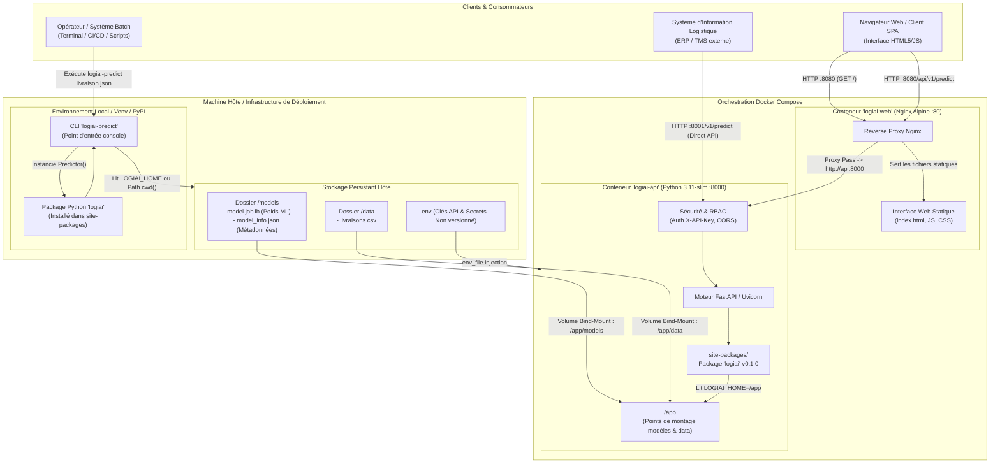

# Étude de Conception Détaillée — Système LogiAI

**Module :** Développement et déploiement d’applications intelligentes  
**Encadrante :** Pr. Soukaina Gouraguine  
**Année Universitaire :** 2026-2027  
**Projet :** LogiAI — Prédiction intelligente du risque de retard des livraisons  
**Version du document :** 1.2 (Post Atelier 6 — Architecture Package & Conteneurisation)

---

## 1. Introduction et Objectifs

### 1.1 Contexte métier
Dans le secteur logistique et de la livraison du dernier kilomètre, les retards imprévus engendrent des coûts d'exploitation majeurs, perturbent les chaînes d'approvisionnement et dégradent l'expérience client.  
Le projet **LogiAI** est conçu comme un système intelligent d'aide à la décision permettant d'évaluer, en amont ou en cours de tournée, la probabilité de retard d'une livraison selon les conditions environnementales, opérationnelles et géographiques.

### 1.2 Objectifs techniques et industriels
L'objectif central de LogiAI est de transformer un modèle prédictif de Machine Learning expérimental en un produit logiciel industrialisé répondant aux standards DevSecOps et MLOps les plus rigoureux :
1. **Packaging standardisé (PEP 517 / PEP 621) :** Fournir une bibliothèque Python réutilisable (`logiai`), installable via pip sous forme de roue (wheel `.whl`), sans couplage avec des chemins de fichiers locaux rigides.
2. **Double interface d'exploitation :**
   - Une interface en ligne de commande (CLI `logiai-predict`) pour les opérateurs de logistique, scripts batch et ordonnanceurs (cron, Airflow).
   - Une API REST haute performance (FastAPI) pour l'intégration web et mobile en temps réel.
3. **Sécurité et Contrôle d'accès :** Authentification par clé d'API (`X-API-Key`), modèle RBAC (Utilisateur standard vs Administrateur avec droit de rechargement à chaud), et politique CORS restrictive.
4. **Architecture conteneurisée et orchestration :** Déploiement multi-services avec Docker Compose, découplage Reverse Proxy Nginx / Backend FastAPI, et montage de volumes pour la persistance et l'actualisation à chaud des modèles ML.
5. **Fiabilité et Assurance Qualité :** Couverture par tests automatisés Pytest (tests unitaires, tests limites, tests de robustesse/fuzzing, tests de sécurité, tests d'intégration du package), analyse statique de code via Ruff.

---

## 2. Architecture Globale du Système

### 2.1 Schéma d'Architecture Mermaid

Le diagramme suivant illustre l'architecture complète du système LogiAI intégrant le package, la ligne de commande CLI, l'orchestration Docker Compose, le Reverse Proxy Nginx, l'API FastAPI et la gestion découplée des artefacts ML.



### 2.2 Rôle des composants et flux d'interaction

1. **Package Python `logiai` :** Contient la logique d'inférence (`Predictor`), la validation des données, le pipeline d'entraînement (`Trainer`), la gestion de la configuration (`config.py`) et l'interface en ligne de commande (`cli.py`). Il est installé dans `site-packages` tant dans le venv local que dans l'image Docker de production.
2. **Point d'entrée CLI (`logiai-predict`) :** Exécutable enregistré dans le `PATH`. Il charge un fichier JSON décrivant une livraison, valide son schéma, résout le modèle via `LOGIAI_HOME` ou `Path.cwd()`, et retourne la probabilité avec mention `(ALERTE)` si le seuil critique ($0.40$) est franchi.
3. **Moteur d'API REST (`FastAPI`) :** Expose les endpoints de diagnostic (`/health`), de prédiction unitaire (`/v1/predict`) et d'administration (`/v1/reload-model`).
4. **Reverse Proxy `Nginx` :** Point d'entrée web public unique (port `8080`). Il élimine les problématiques CORS pour le navigateur en servant le frontend statique sur `/` et en relayant les appels `/api/*` vers le service backend `api:8000`.
5. **Stockage découplé et Volumes :** Les artefacts binaires (`models/`) et les données volumineuses (`data/`) sont gérés en volumes bind-mount, séparant strictement le code applicatif des artefacts de données.

---

## 3. Spécification des Interfaces

### 3.1 Interface REST (FastAPI)

Toutes les requêtes de prédiction et d'administration requièrent l'en-tête HTTP :  
`X-API-Key: <SECRET_KEY>`

#### Matrice des Endpoints

| Méthode | Route | Rôle / Description | Autorisation requise | Code succès | Codes erreurs |
| :--- | :--- | :--- | :--- | :--- | :--- |
| `GET` | `/health` | Diagnostic de l'API et état de chargement du modèle | Public | `200 OK` | `503 Service Unavailable` |
| `POST` | `/v1/predict` | Calcul de probabilité de retard pour une livraison | `User` ou `Admin` | `200 OK` | `401`, `403`, `422` |
| `POST` | `/v1/reload-model` | Rechargement à chaud des artefacts ML en mémoire | `Admin` strict | `200 OK` | `401`, `403`, `500` |

#### Contrat de données d'entrée (`POST /v1/predict`)

```json
{
  "distance_km": 25.5,
  "poids_kg": 12.0,
  "heure_depart": 14,
  "pluie_mm": 3.5,
  "trafic_index": 4.0,
  "nb_arrets": 3,
  "type_vehicule": "fourgon"
}
```

#### Contrat de réponse (`POST /v1/predict`)

```json
{
  "probabilite_retard": 0.4215,
  "alerte": true,
  "seuil": 0.4,
  "model_version": "v1.0"
}
```

### 3.2 Interface en Ligne de Commande (CLI)

* **Syntaxe d'invocation :**
  ```bash
  logiai-predict <chemin_vers_fichier.json>
  ```
* **Codes de sortie système (Exit Codes) :**
  - `0` : Exécution réussie, prédiction affichée sur `stdout`.
  - `1` : Erreur (argument manquant, fichier JSON introuvable, syntaxe JSON invalide, modèle introuvable, variables manquantes).
* **Format de sortie standard (`stdout`) :**
  - Sans alerte : `Probabilité de retard : 3.9 %`
  - Avec alerte ($P \ge 0.40$) : `Probabilité de retard : 100.0 % (ALERTE)`

---

## 4. Modèle de Données et Gestion du Modèle ML

### 4.1 Variables explicatives (Features)
Le modèle Random Forest repose sur 7 descripteurs métier :

| Variable | Type | Plage / Valeurs admises | Rôle métier |
| :--- | :--- | :--- | :--- |
| `distance_km` | Float | $[0.1, 800.0]$ | Distance totale de la tournée |
| `poids_kg` | Float | $[0.1, 5000.0]$ | Masse du chargement transporté |
| `heure_depart` | Integer | $[0, 23]$ | Heure entière de début de tournée |
| `pluie_mm` | Float | $[0.0, 500.0]$ | Précipitations estimées sur le trajet |
| `trafic_index` | Float | $[1.0, 10.0]$ | Indice de congestion du trafic routier |
| `nb_arrets` | Integer | $[0, 50]$ | Nombre de points de dépose intermédiaires |
| `type_vehicule` | String | `moto`, `voiture`, `fourgon`, `camion` | Catégorie de gabarit du véhicule |

### 4.2 Artefacts du modèle
- **`models/model.joblib` :** Pipeline scikit-learn sérialisé combinant le préprocesseur (One-Hot Encoder pour les catégorielles, StandardScaler/Imputer pour les numériques) et l'estimateur de classification (`RandomForestClassifier`).
- **`models/model_info.json` :** Métadonnées associées au modèle :
  ```json
  {
    "version": "1.0",
    "seuil": 0.4,
    "features": ["distance_km", "poids_kg", "heure_depart", "pluie_mm", "trafic_index", "nb_arrets", "type_vehicule"],
    "date_entrainement": "2026-11-04"
  }
  ```

---

## 5. Stratégie de Packaging et Distribution

### 5.1 Découplage Pyproject vs Requirements
- **`pyproject.toml` (Distribution de bibliothèque) :** Spécifie des dépendances abstraites avec des bornes inférieures ouvertes (`pandas>=2.0`, `scikit-learn>=1.3`, `joblib`, `numpy`). Permet l'installation flexible dans tout environnement tiers sans conflit.
- **`requirements.txt` (Déploiement conteneurisé) :** Spécifie l'ensemble exact des versions validées pour le runtime Docker (`fastapi>=0.110`, `scikit-learn>=1.4`, etc.).

### 5.2 Exclusion des données et modèles de la roue (.whl)
Conformément aux principes MLOps, les artefacts binaires ne sont jamais empaquetés dans la roue distribuée :
- Poids de la roue allégé ($< 10$ Ko).
- Indépendance du cycle de vie du code (Git / PyPI) et du modèle (Model Registry / Object Storage).
- Distribution sécurisée et sans secrets.

---

## 6. Sécurité et Gestion des Accès

1. **Gestion des Secrets par l'Environnement :** Aucune clé API ni mot de passe n'est écrit en dur dans le code ou l'image Docker. Les variables sont injectées via `.env` (exclu de Git par `.gitignore`).
2. **Authentification & Contrôle d'Accès basé sur les Rôles (RBAC) :**
   - Rôle Utilisateur (`LOGIAI_API_KEY`) : Droit de prédiction (`POST /v1/predict`).
   - Rôle Administrateur (`LOGIAI_ADMIN_KEY`) : Droit de prédiction et droit exclusif de rechargement à chaud (`POST /v1/reload-model`).
   - Requête sans clé : Code HTTP `401 Unauthorized`.
   - Requête avec clé insuffisante sur route admin : Code HTTP `403 Forbidden`.
3. **Protection CORS (Cross-Origin Resource Sharing) :** L'API restreint les origines autorisées (`ALLOWED_ORIGINS`). L'utilisation de Nginx en reverse proxy permet en production d'éliminer totalement le cross-origin en servant API et Frontend sur la même origine (`http://localhost:8080`).

---

## 7. Déploiement et Conteneurisation

### 7.1 Architecture Multi-Conteneurs Docker
- **Service `api` :**
  - Image basée sur `python:3.11-slim`.
  - Installation propre du package dans `/usr/local/lib/python3.11/site-packages`.
  - Points de montage `./models:/app/models` et `./data:/app/data`.
  - `Healthcheck` automatisé vérifiant `/health` toutes les 30s.
- **Service `web` :**
  - Image basée sur `nginx:alpine`.
  - Sert l'application web statique sur le port 80.
  - Proxy les requêtes `/api/` vers `http://api:8000/`.
  - Démarrage conditionné à la santé du service `api` (`condition: service_healthy`).

---

## 8. Stratégie de Test et Assurance Qualité

Le projet intègre une suite de tests automatisés complète validée par **Pytest** :
1. **Tests unitaires de base (`test_api.py`) :** Validation du démarrage, de l'état `/health`, de la structure des réponses JSON et de la plausibilité probabiliste.
2. **Tests de résistance et robustesse (`test_casser.py`) :** Vérification du rejet (HTTP 422 / 404) sur champs manquants, types incompatibles, champs inconnus et routes inexistantes via `pytest.mark.parametrize`.
3. **Tests aux limites (`test_limites.py`) :** Validation rigoureuse des bornes minimales et maximales des 7 descripteurs, des valeurs interdites et des formats non conformes.
4. **Tests de sécurité (`test_securite.py`) :** Validation du contrôle d'accès RBAC (401 si clé absente, 403 si clé invalide ou droits insuffisants, 200 sur clés valides).
5. **Tests de packaging et CLI (`test_package.py`) :** Validation de l'installation du package, de l'enregistrement de l'entrypoint console `logiai-predict`, de la robustesse face aux fichiers inexistants, et de l'exactitude de la sortie standard.
6. **Contrôle qualité statique (`Ruff`) :** Analyse syntaxique, respect de la PEP 8 et détection des imports inutilisés.

---

## 9. Décisions d'Architecture (Synthèse des ADR)

* **ADR 001 :** Choix de FastAPI pour la rapidité d'exécution, la validation automatique native via Pydantic et la génération OpenAPI/Swagger.
* **ADR 002 :** Choix d'un estimateur Random Forest pour l'interprétabilité, la gestion robuste des variables mixtes et la calibration probabiliste.
* **ADR 003 :** Stratégie de sécurisation par clé d'API dans l'en-tête HTTP (`X-API-Key`) avec distinction stricte des rôles Utilisateur et Administrateur.
* **ADR 004 :** Déploiement multi-conteneurs avec Reverse Proxy Nginx, isolation réseau Docker Compose et montage dynamique des modèles par bind-mount.
* **ADR 005 :** Packaging Python standard (`pyproject.toml`), découplage strict code/modèle ML via `LOGIAI_HOME`, exclusion du binaire dans le wheel et modernisation du Dockerfile vers une installation en `site-packages`.
